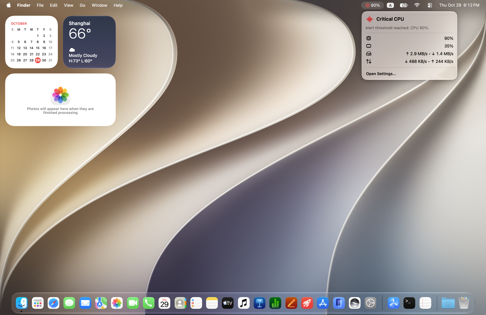

# Alertivity

**Your Mac’s vital signs, always visible.**

Alertivity monitors CPU, memory, disk, network, and process activity. It turns those signals into a simple **Normal**, **Elevated**, or **Critical** status so you can spot problems before they interrupt your work.



[](https://apps.apple.com/app/alertivity/id6756399719)

## Highlights

- **At-a-glance health** — one clear status for your Mac
- **Live metrics** — CPU, memory, disk, and network activity
- **Smart menu bar icon** — show a chosen metric or automatically follow Critical activity in your preferred metric order
- **Useful alerts** — get notified when critical activity persists
- **Process insights** — identify, inspect, ignore, or terminate resource-heavy processes¹
- **Made for macOS** — launch at login, optional Dock icon, and a localized SwiftUI interface

¹ Process monitoring is available in the non-sandboxed build.

## Getting Started

1. Open Alertivity and follow the optional welcome guide.
2. Click the menu bar icon to view your Mac’s status and live metrics.
3. Open **Settings** to choose your menu bar display, adjust activity thresholds, and enable notifications. Allow notification permission when prompted to receive alerts.

In **Settings → Notifications**, choose a notification cooldown of 1, 5, 10, 15, 30, or 60 minutes (default: 10). This minimum interval is shared by all system and process alerts. Changes apply immediately using the last notification attempt; the preference is saved, while the cooldown timer resets when the app restarts. The high-activity duration separately controls how long a critical condition must persist before an alert qualifies.

### Menu bar summaries

The summary identifies configured **alert thresholds** that current activity has reached,
for example, “Alert thresholds reached: CPU 80% and Memory 70%.” These numbers are
thresholds, not live readings; the metric rows below show current values. “Reached”
includes equality and values above the threshold. A threshold triggers a notice rather
than imposing a resource limit.

See [Metrics and status](wiki/Metrics-and-Status.md) for examples and [the developer guide](wiki/Developer-Guide.md#menu-summaries) for formatting details.

## Documentation

Read the [GitHub wiki](https://github.com/nobbbbby/Alertivity/wiki) for settings, notifications, troubleshooting, and development. Page sources are in [wiki/](wiki/Home.md); see [Editing the wiki](wiki/Maintaining-the-Wiki.md) to publish updates.

## Choose a Version

### Mac App Store

The sandboxed version provides system-wide health monitoring and critical-status notifications. Process-level monitoring is unavailable because of App Store sandbox restrictions.

Alertivity Pro is a one-time in-app purchase for custom system thresholds, notification cooldown, high-activity duration, and Auto-switch metric priority. Free monitoring uses the default thresholds, a 10-minute cooldown, a 60-second duration, and CPU → Memory → Disk → Network priority. All other current App Store features remain free. Saved custom settings are preserved and restored when Pro access is verified. See [Free and Pro settings](wiki/Settings.md#free-and-pro-in-the-mac-app-store-build).

[Download Alertivity from the Mac App Store](https://apps.apple.com/app/alertivity/id6756399719)

### Non-sandboxed

Build from source to unlock process-level activity, process CPU and memory detection thresholds, ignored-process rules, and quick actions for Activity Monitor or force quit. The open-source build remains fully unlocked, including all monitoring customization; no Pro purchase is required.

## Build from Source

Requirements: **macOS 14 (Sonoma) or later** and a compatible stable Xcode. See the [developer guide](wiki/Developer-Guide.md) for tooling details.

1. Open `Alertivity.xcodeproj` in Xcode.
2. Select the **Alertivity (Non-sandboxed)** scheme.
3. In **Signing & Capabilities**, select your available Apple development team for signing. Add your Apple account in **Xcode → Settings → Accounts** if needed.
4. Press **Run**.

Or build from Terminal:

```sh
xcodebuild \
  -scheme 'Alertivity (Non-sandboxed)' \
  -configuration Release \
  -destination 'platform=macOS' \
  build
```

For Terminal builds, add `DEVELOPMENT_TEAM=YOUR_TEAM_ID` to use your available development team.

## Privacy & Permissions

Read the [Privacy Policy](https://github.com/nobbbbby/Alertivity/wiki/Privacy-Policy) for data use and storage. Alertivity monitors activity locally. Notifications require macOS authorization. Revealing a process in Activity Monitor may require Accessibility permission for System Events.

## Languages

English, German, French, Japanese, and Simplified Chinese. See the [localization guide](wiki/Localization.md) to maintain translations.
